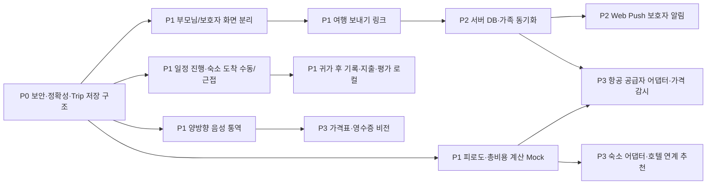

# easy-travel MVP 전면 검토와 개선 로드맵

> 기준일: 2026-10-31 · 검토 대상: `main` @ `caef1bc` · 작업 브랜치: `claude/p0-hardening`
>
> 요청서에 언급된 `EASY_TRAVEL_OPUS_MVP_REVIEW_SPEC_KO.md`는 로컬·원격 어디에도 없어, 사용자 요청문과
> `README.md` · `CLAUDE_HANDOFF_KO.md` · `EASY_TRAVEL_PRODUCT_MAP_KO.md` · `RESEARCH_BRIEF_KO.md` · `WORK_LOG_KO.md`를 기준으로 검토했습니다.
> 스펙 파일을 받으면 이 문서와 대조해 차이를 반영합니다.

## 0. 요약

- 현재 앱은 **한 화면(`app/page.tsx` 862줄, 단일 클라이언트 컴포넌트)** 에 부모님용 여행 중 기능과 보호자용 계획 기능이 섞여 있습니다.
- 데이터가 `easy-travel-demo`, `easy-travel-planning`, `easy-travel-rates` 세 저장소로 흩어져 **계획 → 실행 → 리뷰가 이어지지 않습니다.** 목적지도 두 군데(계획 폼, 여행 설정)에 따로 있어 서로 달라질 수 있습니다.
- 공개 저장소 + 서버에 OpenRouter 키가 있는 상태에서 **`/api/ai`가 인증·출처 확인·횟수 제한 없이 열려 있습니다.** 지금은 Vercel 배포 보호(Vercel Authentication)로 막혀 있지만, 부모님이 쓰도록 보호를 끄는 순간 누구나 키를 쓸 수 있습니다.
- **Next.js 14.2.35는 14.x의 마지막 패치이며 지원이 끝났고**, `npm audit`에서 critical 1건·high 1건(next, postcss)이 나옵니다. 수정판은 15.5.x/16.x에만 있습니다.
- 목적지와 상관없이 **프랑스어 문장·유로·에어프랑스 후보**가 나오는 등 데모 데이터가 목적지와 맞지 않는 정확성 버그가 있습니다.
- Vercel(UTC)에서 빌드하면 정적 HTML에 UTC 시각이 박혀 **한국 브라우저에서 하이드레이션 불일치**가 납니다(로컬 KST 빌드에서는 안 보임).

P0는 위 보안·정확성 문제와, 이후 모든 기능이 기대는 **단일 여행 데이터(Trip) 저장 구조**까지로 잡았습니다. 신규 유료 서비스·외부 배포 없이 이 브랜치에서 처리합니다.

---

## 1. 기능 현황: 구현 / 데모 / 미구현

| 영역 | 상태 | 실제 동작 | 비고 |
|---|---|---|---|
| Google Maps 검색·길찾기 | **구현** | URL 방식(키 불필요)으로 외부 지도 앱/브라우저 열기 | 이동수단 선택 포함 |
| 환전 계산 | **구현** | Frankfurter(ECB) 조회, 출처·조회시각·마지막 성공값, 수동 입력 | 브라우저에서 직접 호출 |
| 여행계획서 붙여넣기 | **구현** | 규칙 기반 줄 파싱 → 미리보기 → 선택 등록 | AI 추출(`itinerary_import`)은 서버에만 있고 화면에서 안 씀 |
| 자유 번역 | **구현(키 있을 때)** | OpenRouter 한→현지어 단방향 | 역방향·음성 없음 |
| 사진 장소 추정 | **구현(키 있을 때)** | 1280px 축소·EXIF 제거 후 비전 모델 | 결과가 자유 텍스트라 지도·일정과 연결 안 됨 |
| 자주 쓰는 말 | **버그** | 항상 프랑스어 | 목적지 무관 |
| 긴급전화 | **구현** | 가족이 넣은 번호 + 영사콜센터, 확인 후 `tel:` | |
| 여행 전 계획 폼 | **데모** | 입력값으로 일수·예상비용 계산 | 비용 계수는 단순 가정 |
| 항공권 후보 | **데모** | 하드코딩 3개, 목적지 무관 항공사·가격 | “실시간 아님” 표시는 있음 |
| 가격 모니터링 | **데모** | 켜짐/꺼짐 상태만 저장 | 조회·알림 없음 |
| 안부·SOS | **데모** | 이 기기에 시각·위치 기록 | 보호자 전송 없음(문구로 명시됨) |
| 가족 공유 링크 | **데모(깨짐)** | `/family/코드` 복사 | 해당 경로가 없어 404 |
| 호텔 연계 추천·피로도·총비용 비교 | **미구현** | | |
| 일정 진행 확인·숙소 도착 알림 | **미구현** | | |
| 상품 가격·현지 시세 | **미구현** | | |
| 양방향 음성 통역 | **미구현** | | |
| 귀가 후 기록·실제 비용·평가 | **미구현** | | |
| 부모님/보호자 화면 분리 | **미구현** | 한 화면에 모두 있음 | |
| 서버 저장·가족 동기화·푸시 | **미구현** | 전부 `localStorage` | |

---

## 2. 현재 코드의 문제점

심각도: **P0** = 지금 고쳐야 함(보안·잘못된 정보·이후 작업의 기반), **P1** = MVP 완성도, **P2** = 확장 전 정리

### 2.1 보안

| # | 심각도 | 문제 | 근거 |
|---|---|---|---|
| S1 | P0 | `/api/ai`가 누구나 호출 가능한 OpenRouter 프록시. 출처 확인·접속 코드·횟수 제한 없음 | `app/api/ai/route.ts` 전체. 저장소가 공개라 엔드포인트 형식도 공개됨 |
| S2 | P0 | Next.js 14.2.35 지원 종료 + critical/high 취약점 | `npm audit --omit=dev`: next(critical, RSC DoS·캐시 오염 등), postcss(high). 14.2.x 추가 패치 없음 |
| S3 | P0 | 사용자 입력을 지시문에 이어 붙이는 프롬프트(프롬프트 주입으로 임의 용도 사용 가능) | `promptFor()`가 `text`를 지시문 문자열에 연결 |
| S4 | P0 | 외부 AI 호출에 타임아웃 없음 → 함수 실행 시간·비용 낭비 | `fetch(openrouter)`에 `signal` 없음 |
| S5 | P0 | 화면에서 쓰지 않는 `itinerary_import`(6,000자·800토큰)가 열려 있어 공격면만 넓힘 | route.ts, page.tsx에 호출 없음 |
| S6 | P1 | 보안 헤더 없음(CSP, Referrer-Policy, Permissions-Policy, nosniff) | `next.config.mjs` |
| S7 | P1 | `package-lock.json` 없음 → Vercel 빌드마다 하위 의존성 버전이 달라질 수 있음 | 저장소 파일 목록 |
| S8 | P2 | 가족 코드가 단순 문자열이고 서버 권한 모델 없음 | 서버 공유 도입 시 함께 설계 |

비밀값 노출 점검: git 전체 이력에서 `sk-or-`·키 대입 패턴 없음(확인 완료).

### 2.2 정확성·데이터

| # | 심각도 | 문제 |
|---|---|---|
| D1 | P0 | 데이터가 3개 저장소로 분산, 목적지가 `planning.destination`과 `destination` 두 곳 → 서로 다른 값이 될 수 있음 |
| D2 | P0 | 목적지와 무관한 프랑스어 문장·EUR 기본값·에어프랑스 후보(도쿄를 골라도 에어프랑스) |
| D3 | P0 | Vercel(UTC) 빌드 시 데모 조회시각이 `오전 12:30`으로 박히고 한국 브라우저는 `오전 9:30`을 그려 하이드레이션 불일치 (UTC/KST 포맷 비교로 재현) |
| D4 | P0 | 첫 화면 `📅 10월 18–22일`, `가족 3명`, 아바타 `김`이 하드코딩 → 계획(11/6–11/10, 2명)과 다름 |
| D5 | P0 | 사이드바에 “OpenRouter·Upstash 키” 문구 — Upstash는 코드에 없음 |
| D6 | P0 | 가족 링크가 존재하지 않는 `/family/...`를 복사 |
| D7 | P1 | 항공 가격이 문자열(`"₩1,248,000"`) → 비교·정렬·총비용 계산 불가. ‘최저가’ 표시가 계산이 아니라 고정값 |
| D8 | P1 | 새 장소의 Day가 `min(3, 개수+1)`로 임의 배정. 일정에 시간·상태(완료/건너뜀) 없음 |
| D9 | P1 | “다음 일정”이 날짜와 무관하게 항상 첫 장소 |

### 2.3 코드 구조

- `page.tsx` 한 파일에 상태 40여 개, 도메인 계산·저장·외부 호출·UI가 섞여 있어 테스트가 불가능합니다.
- 도메인 타입(`PlanningForm`, `FlightCandidate` 등)이 UI 파일 내부에 있어 서버 API와 공유할 수 없습니다.
- 테스트가 하나도 없습니다(`npm run lint`도 ESLint 미설치로 동작 안 함).
- CSS가 “기본 → 가독성 보정 → 리뷰 보정” 덮어쓰기 층으로 쌓여 같은 선택자가 여러 번 정의됩니다(P2 정리).

### 2.4 사용성(부모님 기준)

- 부모님이 여행 중 보는 화면에 계획 폼·항공 후보·환율 출처 같은 보호자용 정보가 길게 이어집니다. 메뉴 6개, 한 페이지 스크롤.
- 통역이 단방향(한→현지어)이라 상대방 말을 이해할 방법이 없습니다. 음성 입력·읽어주기 없음.
- “다음 일정”이 날짜·진행 상황을 모르니 여행 이틀째에도 첫날 장소를 보여줍니다.
- 글자 크기·터치 영역은 보정 층 덕분에 대체로 기준(본문 17px, 버튼 48px)을 지킵니다. 유지할 점입니다.

### 2.5 배포

- 운영 주소 `easy-travel-dosl.vercel.app`은 **Vercel Authentication으로 보호 중**(외부 요청 401). 부모님이 쓰려면 이 보호를 꺼야 하므로 S1을 먼저 해결해야 합니다.
- Vercel Hobby는 **비상업용**이고, Cron은 **하루 1회**까지만 가능합니다. “한 시간마다 가격 확인”은 Hobby로 약속할 수 없습니다.
- `OPENROUTER_SITE_URL` 기본값이 `localhost:3000`이라 Vercel 환경변수에 넣지 않으면 OpenRouter 통계에 잘못된 출처가 남습니다.

---

## 3. 개선 아키텍처

### 3.1 하나의 여행 데이터(Trip)로 계획·실행·리뷰 연결

```text
Trip (schemaVersion)
├─ profile      목적지·출발지·날짜·인원·예산·선호·숙소·현지 긴급번호
├─ phase        planning → ready → traveling → returned → reviewed   (날짜로 자동 추정 + 수동 변경)
├─ planning     항공 후보(가격은 숫자·출처·조회시각), 숙소 후보, 추천 일정, 가격 감시 설정
├─ itinerary    Day별 장소: 이름·메모·예정 시각·상태(예정/완료/건너뜀)·좌표(선택)
├─ journal      안부·SOS 기록, 숙소 도착 기록, 사진 메모
├─ expenses     예상(계획) vs 실제(지출) — 금액·통화·환율·분류·결제자·확정 여부
└─ review       장소·숙소·항공 평가, 체감 피로도, 다음 여행 조건
```

- 계획 단계의 결과(항공·숙소·일정·예상 비용)가 그대로 여행 중 화면의 입력이 되고, 여행 중 기록(완료한 장소·지출·안부)이 귀가 후 리뷰의 입력이 됩니다.
- 기기 캐시(환율 등)는 Trip과 분리합니다.
- 저장소는 `TripRepository` 인터페이스 뒤에 둡니다. **지금은 localStorage 구현**, 가족 동기화가 필요해지면 서버 DB 구현으로 바꿉니다. 화면 코드는 바뀌지 않습니다.

### 3.2 모듈 구조(모듈형 모놀리스 유지)

```text
app/
  page.tsx                 역할 선택 → /parent 또는 /guardian (P1)
  parent/                  부모님 화면: 오늘·다음 이동·호텔로·통역·도움
  guardian/                보호자 화면: 계획·비교·공유·감시·정산
  api/ai/route.ts          AI 게이트웨이(작업별 검증·접속 코드·제한)
  api/prices/…             가격 감시 실행(P3, Cron/외부 스케줄러가 호출)
lib/
  trip.ts                  Trip 타입·생성·선택자(오늘 Day, 다음 장소, 예산 합계)
  tripStorage.ts           저장·스키마 버전·구버전 마이그레이션
  destinations.ts          목적지 프로필(언어·통화·문장·데모 항공사·비용 계수)
  server/aiGuard.ts        출처·접속 코드·횟수 제한·입력 검증
  integrations/            Port/Adapter: FlightPrice, Hotel, Places, Notifier, Ai (P3~)
tests/                     node --test (순수 함수·마이그레이션·가드)
```

### 3.3 부모님 / 보호자 화면 구분

| | 부모님 화면 | 보호자 화면 |
|---|---|---|
| 목적 | 지금 할 일 하나 | 준비·비교·확인 |
| 첫 화면 | 다음 장소 + “길찾기” 큰 버튼, 호텔로, 통역, 도움 | 여행 상태, 할 일 체크리스트, 가격 감시 |
| 편집 | 없음(완료/도착/안부만 누름) | 계획·일정·숙소·연락처·공유 범위 |
| 글자 | 본문 20px+, 버튼 60px | 본문 16–17px |
| 데이터 연결 | P1: 보호자가 만든 “여행 보내기” 링크로 가져오기(URL 조각, 서버 미전송) / P2: 서버 동기화 | |

### 3.4 기존 Vercel·OpenRouter 재사용

- AI는 계속 `/api/ai` 하나로 받되 작업(`translate`, `photo_location`, 이후 `price_tag`, `receipt`, `transcribe`)마다 입력 검증·토큰 상한·모델을 분리합니다. 모델은 지금처럼 환경변수로 바꿉니다.
- 가격 감시는 Vercel Cron(Hobby 하루 1회) 또는 GitHub Actions 예약 작업(공개 저장소 무료)이 비밀 토큰으로 `/api/prices/run`을 호출하는 방식으로 시작합니다.
- DB가 필요해지면 Vercel Marketplace의 Neon(무료 플랜, 비활성 자동 일시정지 없음)을 권장합니다. Supabase 무료 플랜은 1주 비활성 시 일시정지되어 여행 사이 기간이 긴 가족 앱에 불리합니다.

---

## 4. 기능별 구현 방법

### 4.1 항공권 가격 모니터링 (요청 3)

- **현재 상태**: 데모. 가격이 문자열이고 감시는 상태값만 있습니다.
- **설계**
  - `FlightPriceProvider.search(query) → FlightQuote[]` Port. `FlightQuote = {가격(숫자, KRW), 통화 원문, 항공사, 경유 횟수, 총 소요, 출발·도착 시각, 수하물 포함 여부, 출처, 조회시각, 예약 링크}`.
  - `PriceWatch = {검색 조건, 목표가, 마지막 최저가, 이력[], 다음 확인 시각}`를 Trip에 저장 → 서버 저장 이후 스케줄러가 하루 1회 확인 → 목표가 이하·최근 7일 최저 대비 N% 하락 시 보호자에게 알림.
  - 화면은 “조회 시점 참고 가격 · 출처 · 조회 시각”을 항상 표시하고 예약은 공식 링크로만 보냅니다(예약·결제 대행 안 함 유지).
- **공급자 선택**
  - Amadeus Self-Service는 **2026-07-17 종료**되어 신규 사용 불가(엔터프라이즈 계약만 가능).
  - 1순위: **Travelpayouts(Aviasales) Data API** — 무료·제휴 기반. 사용자 검색 캐시(최대 7일) 가격이라 “추세·하락 감지”용으로 적합하고, 실제 가격은 예약 링크에서 다시 확인하라고 표시해야 합니다.
  - 2순위: **Duffel** — 실시간 오퍼. 검색 자체는 과금 없고 예약 대비 검색 비율(1500:1) 초과분만 건당 $0.005. 가족 감시(하루 몇 회) 수준이면 사실상 무료. 예약은 하지 않으므로 비율 초과 과금만 발생.
  - 피할 것: SerpApi(Google Flights) — 월 $75부터, 스크래핑 기반.

### 4.2 호텔 연계 추천 (요청 3)

- 항공 도착 시각·공항 → “첫날 숙소까지 이동” 비용·시간을 계산하고, 일정 장소들과의 거리로 숙소 지역을 추천합니다.
- 점수 = 공항 이동 편의(직행 철도·리무진 여부, 환승 수) + 일정 장소까지 평균 이동 시간 + 엘리베이터·대욕장 등 부모님 편의 태그 + 1박 가격.
- 체크인 시각과 항공 도착 시각을 비교해 “짐 맡기기 필요”, 늦은 도착이면 “공항 근처 1박” 같은 안내를 냅니다.
- 데이터: MVP는 보호자가 숙소 후보를 직접 넣고(이름·주소·가격) 예약은 Booking/Agoda 검색 링크로 보냅니다(키 불필요). 이후 **LiteAPI**(무료 가입, 예약 대비 검색 5000:1까지 무과금) 어댑터. 이동 시간은 Google Routes API(Essentials 월 1만 건 무료 구간) 또는 직선거리 기반 추정으로 시작.

### 4.3 이동 피로도와 총비용 비교 (요청 3)

- **피로도 점수(0–10)**: 비행시간, 경유 횟수·대기 시간, 야간 비행, 이른 출발(8시 전)·늦은 도착(22시 후), 시차, 공항→숙소 환승 수, 하루 걷는 시간, 하루 이동 구간 수.
- **총비용**: 항공 + 숙박 + 공항 이동 + 현지 교통(숙소↔일정) + 식비·입장료 추정. 항목별로 출처(실조회/추정)를 표시.
- **비교 화면**: 후보 조합(항공×숙소)마다 “총비용 · 피로도 낮음/보통/높음 · 이유 2줄”. 보호자가 “편안함 우선 / 균형 / 비용 우선”을 고르면 정렬 가중치만 바뀝니다.
- 점수 계산은 순수 함수로 두고 테스트로 고정합니다. 외부 API 없이 데모 데이터로 먼저 검증할 수 있습니다.

### 4.4 사진으로 장소 찾기 (요청 4)

- 지금은 자유 텍스트 결과라 다음 행동으로 이어지지 않습니다.
- 응답을 JSON(`후보[{이름, 현지 표기, 신뢰도, 근거}]`)으로 받고 서버에서 검증 → 후보마다 “지도에서 보기 / 여기로 길찾기 / 일정에 추가” 버튼.
- 사용자가 동의하면 사진의 EXIF 대신 **현재 위치(대략, 소수 2자리)** 를 함께 보내 후보를 좁힙니다. 기본은 꺼짐.
- 선택: Google Places Text Search로 후보 실존 확인(Pro 구간 월 5천 건 무료).

### 4.5 상품 가격·현지 시세 분석 (요청 4)

- 범위를 “**가격표·메뉴 읽기 + 원화 환산 + 일반적인 가격대 참고(추정)**”로 한정합니다. 제품 지도의 금지 항목(“사진만으로 정확한 현지 가격 보장”)을 지킵니다.
- 흐름: 사진 → 비전 모델이 품목·가격·통화 추출(JSON) → 사용자 확인 → 저장된 환율로 원화 환산 → “보통 이 정도 범위로 알려져 있어요(AI 추정)” 표시 → 원하면 지출로 기록.
- 장기적으로는 easy-travel 사용자의 **확정 지출 데이터(동의·익명 집계)** 를 현지 시세 참고값으로 씁니다(Phase 4).

### 4.6 양방향 음성 통역 (요청 4)

- **마주 보기 화면**: 아래쪽은 부모님(한국어), 위쪽은 180° 뒤집힌 상대방(현지어) 영역. 각자 “말하기” 버튼.
- 음성 인식: 브라우저 Web Speech API(`SpeechRecognition`, iOS는 `webkitSpeechRecognition`). 지원이 부분적이고 iOS는 긴 연속 인식이 불안정하므로 한 문장 단위로 사용. 미지원 기기는 녹음(MediaRecorder) → `/api/ai`의 `transcribe` 작업(오디오 입력 지원 모델) → 실패 시 키보드 입력.
- 번역: `/api/ai` `translate`에 `direction`(한→현지어 / 현지어→한) 추가.
- 읽어주기: `speechSynthesis`(무료, 기기 음성). 해당 언어 음성이 없으면 큰 글씨만 표시.
- 목적지 프로필의 언어 코드(`ja-JP`, `th-TH`, `vi-VN`, `fr-FR`)를 그대로 사용합니다(P0에서 프로필 도입).

### 4.7 일정 진행 확인 (요청 4)

- 일정 항목에 예정 시각·상태(예정/진행 중/완료/건너뜀) 추가. 여행 날짜와 **목적지 시간대** 기준으로 “오늘 Day N”을 계산.
- 부모님 화면: “지금: ○○ / 다음: △△” + 큰 버튼 “여기 도착했어요”, “다음으로”. 누르면 기록만 하고 자동 판단하지 않습니다.
- 보호자 화면: 진행 막대와 마지막 기록 시각. 기록이 없으면 “확인 불가”로 표시(“위험” 표현 금지).

### 4.8 숙소 도착 알림 (요청 4)

- 웹은 백그라운드 지오펜스를 할 수 없습니다. 그래서 단계적으로:
  1. **수동**(P1): 부모님 화면 “숙소에 도착했어요” 버튼 → 기록.
  2. **앱이 열려 있을 때 근접 확인**(P1): “호텔로 돌아가기”를 누르면 그 동안만 `watchPosition`으로 숙소 좌표 150m 안에 들어왔는지 확인 → “도착하셨나요?” 확인 후 기록. 화면을 닫으면 멈춥니다.
  3. **보호자 알림**(P2): 서버 저장 + Web Push(VAPID, 무료. iOS는 16.4+에서 홈 화면 추가 시에만) 또는 이메일. 알림 성공/실패를 분리해 기록.
  4. 진짜 백그라운드 지오펜스는 네이티브 앱 단계에서 검토.

### 4.9 귀가 후 기록·실제 비용·평가 (요청 5)

- 귀국일 다음 날 phase가 `returned`로 바뀌면 보호자·부모님 화면 모두 “여행 정리하기”를 첫 행동으로 보여줍니다.
- **기록**: 완료한 장소·안부·도착 기록으로 날짜별 타임라인 자동 구성 + 사용자가 고른 사진·메모.
- **실제 비용**: 여행 중 “빠른 지출 입력”(금액·통화·분류·결제자) + 영수증 사진(비전 추출 → 사용자 확인 후 확정). 계획 예산 대비 분류별 차이, 1인당 분담액.
- **평가**: 장소·숙소·항공마다 3단계 큰 버튼(좋았어요/보통/별로) + 체감 피로도. 결과를 “다음 여행 조건”(직항 선호, 하루 이동 2곳 이하 등)으로 저장해 다음 계획의 기본값으로 씁니다.

---

## 5. 외부 API와 예상 비용

가족 1팀이 연 2–3회 여행하는 규모 기준. 금액은 2026-10 시점 공개 정보이며 계약 전 공식 가격표로 다시 확인해야 합니다.

| 용도 | 후보 | 비용 | 메모 |
|---|---|---|---|
| 호스팅 | Vercel Hobby(현재) | $0 | 비상업용 한정, Cron 하루 1회. 유료화·상업화 시 Pro $20/월 |
| AI(번역·사진·영수증) | OpenRouter(현재) + gpt-4o-mini급 | 월 $1 미만 예상 | 번역 1회 ≈ 200토큰, 사진 1회 ≈ 1–2천 토큰. 입력 $0.15/출력 $0.60 per 1M 토큰 |
| 음성 인식 | Web Speech API → (대안) OpenRouter 오디오 모델 | $0 → 소액 | 대안 모델은 오디오 토큰 과금 |
| 읽어주기 | `speechSynthesis` | $0 | 기기 음성 품질 편차 |
| 환율 | Frankfurter(ECB) | $0 | 정보 제공용, 거래 환율 아님 |
| 항공 가격 | Travelpayouts Data API / Duffel | $0 / 사실상 $0 | Amadeus Self-Service 종료(2026-07-17) |
| 숙소 | 검색 링크 / LiteAPI | $0 | LiteAPI는 검색:예약 5000:1 초과분만 과금 |
| 지도·장소·경로 | Google Maps URL(현재) / Places·Routes API | $0 / 무료 구간 내 $0 | API는 결제 계정 필요, SKU별 월 무료 한도(Essentials 1만·Pro 5천) |
| DB | Neon 무료 플랜 | $0 | 자동 일시정지 없음, 프로젝트당 저장 용량 제한 |
| 알림 | Web Push(VAPID) | $0 | iOS는 홈 화면 추가 필요 |
| 예약 작업 | Vercel Cron(일 1회) / GitHub Actions | $0 | 시간 단위 감시는 외부 스케줄러 필요 |

**피해야 할 비용 함정**: OpenRouter 키 사용 한도 미설정(무제한 과금 위험), Google Maps API 키 제한 미설정, SerpApi 같은 월정액 스크래핑 API.

---

## 6. 단계별 로드맵



| 단계 | 내용 | 신규 비용·외부 의존 | 사용자 승인 필요 |
|---|---|---|---|
| **P0** (이 브랜치) | AI 라우트 보호·Next 16 업그레이드·보안 헤더·lockfile, 하이드레이션 수정, 목적지 프로필, 단일 Trip 저장+마이그레이션, 오해 문구·죽은 링크 정리, 테스트 도입 | 없음 | main 병합, Vercel 환경변수(`EASY_TRAVEL_ACCESS_CODE`) 추가 |
| **P1** | 화면 분리, 일정 진행·숙소 도착(수동/근접), 양방향 음성 통역, 귀가 후 기록·지출·평가(로컬), 피로도·총비용(Mock), 여행 보내기 링크 | 없음 | 화면 구성안 확인 |
| **P2** | 서버 DB(Neon)·가족 초대/권한·공유 범위, Web Push | Neon 무료, VAPID 키 | DB 생성·개인정보 처리 방침 |
| **P3** | 항공(Travelpayouts→Duffel) 어댑터와 하루 1회 감시, 숙소 어댑터·호텔 추천, 가격표·영수증 비전 | 공급자 가입(무료) | 공급자 약관·키 발급 |
| **P4** | 사용 데이터 기반 시세 참고·추천 개선, 네이티브 앱(백그라운드 지오펜스) 검토 | 미정 | 별도 결정 |

---

## 7. P0 작업 범위 (이 브랜치)

1. **AI 라우트 보호**: 같은 출처 확인, 선택형 가족 접속 코드(`EASY_TRAVEL_ACCESS_CODE`), IP별 횟수 제한(인스턴스 단위 최선 노력), OpenRouter 20초 타임아웃·`maxDuration`, 시스템/사용자 메시지 분리, 목적지 프로필로 번역 대상 언어 지정, 미사용 `itinerary_import` 제거.
2. **프레임워크·배포 위생**: Next 16 / React 19 업그레이드, 보안 헤더, `package-lock.json`, 동작하는 `typecheck`·`test` 스크립트.
3. **하이드레이션 수정**: 시각은 브라우저에서 마운트 후에만 포맷.
4. **목적지 프로필**: 프랑스·일본·태국·베트남 + 영어 기본값. 문장·통화·데모 항공사·비용 계수를 한 곳에서.
5. **단일 Trip 저장**: `easy-travel:trip` 하나로 통합, 기존 두 저장소에서 자동 이전, 첫 화면 날짜·인원을 실제 계획값으로.
6. **오해 문구·죽은 링크 정리**: Upstash 문구 제거, 가족 링크는 “준비 중”으로 명확히.
7. **테스트**: `node --test`로 도메인 계산·마이그레이션·AI 가드 검증.

P0에서 하지 않는 것: 화면 분리, 실제 항공/숙소 API, 서버 DB, 푸시, 음성 통역(모두 P1 이후).

## 8. 사용자가 해야 할 일(배포 전)

- OpenRouter 대시보드에서 **이 키의 사용 한도(credit limit)** 설정 — 가장 확실한 비용 상한.
- 병합 후 Vercel 환경변수에 `EASY_TRAVEL_ACCESS_CODE`(가족끼리 공유할 코드)와 `OPENROUTER_SITE_URL=https://easy-travel-dosl.vercel.app` 추가.
- 그다음에 Vercel Authentication을 끄고 부모님 기기에서 접속.

## 참고 자료

- Amadeus Self-Service 종료: <https://airlabs.co/amadeus-self-service-api-shutdown>, <https://ignav.com/docs/amadeus-self-service-shutdown>
- Travelpayouts Data API: <https://support.travelpayouts.com/hc/en-us/articles/203956163>
- Duffel 가격: <https://duffel.com/pricing>
- LiteAPI 과금: <https://docs.liteapi.travel/docs/faq>
- Google Maps Platform 가격: <https://developers.google.com/maps/billing-and-pricing/pricing>
- Vercel 제한: <https://vercel.com/docs/limits>
- Web Speech API 지원: <https://caniuse.com/speech-recognition>
- Neon 무료 플랜: <https://neon.com/faqs/free-plan-limits-and-quotas>
