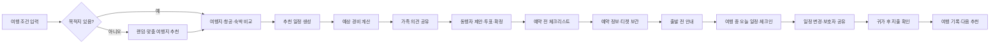
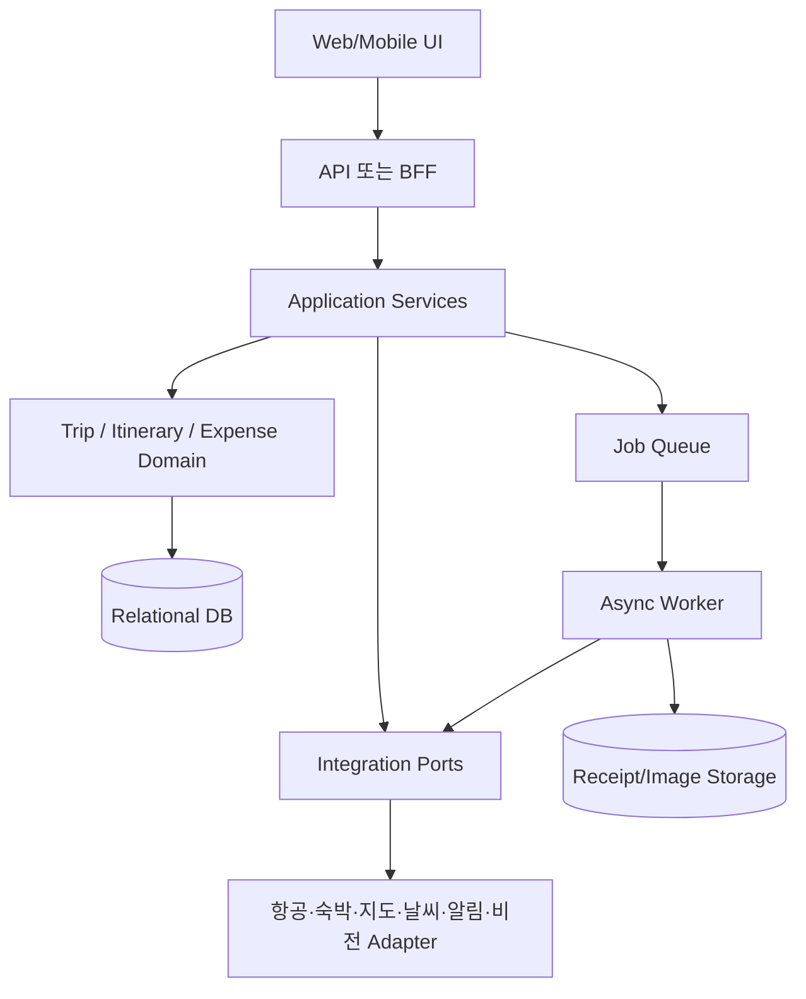

# easy-travel 제품 지도

> 부모님·가족·친구가 함께 여행을 발견하고, 결정하고, 준비하고, 여행 중 서로 돕고, 귀가 후 정리하는 여행 도우미

## 1. 제품 정의

easy-travel은 항공권을 대신 구매하거나 누구의 안전을 보장하는 서비스가 아니다. 가족 여행뿐 아니라 친구·커플·다세대 동행자가 하나의 여행을 함께 계획하고 각자 필요한 정보만 공유하는 서비스다.

핵심 가치는 다음 한 문장으로 정의한다.

> 여행자는 직접 결정할 수 있고, 동행자는 함께 계획하며, 보호자는 동의된 정보만 확인한다.

### 사용자 역할

| 역할 | 주요 사용 방식 |
|---|---|
| 여행자/부모님 | 큰 글씨로 오늘 일정, 다음 이동, 연락처, 체크인 확인. 계획을 직접 입력·확정할 수 있음 |
| 여행 소유자 | 여행 생성, 참여자 초대·철회, 예약·비용 공유 범위 결정 |
| 공동 계획자/동행 친구 | 여행지 후보, 일정, 숙소, 예산을 제안·수정하고 의견을 남김 |
| 보호자/보기 전용 초대자 | 공유된 일정·안부·항공 상태 확인 |

보호자가 대신 입력할 수는 있지만, 예약·결제·위치·사진·문자 공유는 여행자 또는 정보주체의 확인과 동의를 전제로 한다.

## 2. 전체 서비스 맵



## 3. 사용자 여정과 상태

```text
초안
  → 후보 비교 중
  → 동행자 합의
  → 예약 준비 중
  → 예약 정보 등록
  → 출발 전
  → 여행 중
  → 귀가 완료
  → 정산 검토 중
  → 여행 기록 완료
```

각 상태의 첫 화면은 세 가지만 보여준다.

1. 지금 상태
2. 다음에 할 일
3. 도움이 필요한 사람

| 단계 | 사용자가 하는 일 | 앱이 제공하는 것 |
|---|---|---|
| 발견 | 목적지·기간·예산·걷는 양 입력 | 맞춤/랜덤 여행지 추천 |
| 비교 | 후보를 저장하고 가족 의견 확인 | 가격·이동 부담·일정 피로도 비교 |
| 계획 | 항공·숙박·장소 선택 | 추천 일정·예상 경비·계획서 |
| 예약 준비 | 예약에 필요한 정보 확인 | 체크리스트·공식 예약 링크·문서 보관 |
| 여행 중 | 오늘 일정과 다음 이동 확인 | 큰 글씨 일정·티켓·연락처·체크인 |
| 정산 | 영수증이나 지출 입력 확인 | 분류·환율·사람별 분담액 계산 |
| 회고 | 사진·평가·메모 남김 | 여행 타임라인·다음 추천 조건 |

## 4. 기능 우선순위

### MVP — 반드시 구현

MVP의 목표는 **조건 입력부터 가족과 공유 가능한 여행계획서까지 5분 안에 만드는 것**이다.

| 기능 | MVP 범위 | 완료 기준 |
|---|---|---|
| 여행 생성 | 목적지, 기간, 인원, 예산, 걷는 양, 선호 입력 | 1분 내 입력 가능 |
| 여행지 추천 | 목적지 지정 또는 랜덤 후보 3개 추천 | 후보 저장·선택 가능 |
| 항공 비교 | Duffel 토큰이 있을 때만 실시간 공급자 결과 표시. 토큰이 없으면 설정 안내 | 가격·조회시각·통화·수하물·경유·공식 예약 링크 제공 |
| 숙박 후보 | 항공 예약 후 OpenRouter가 일정 맥락에 맞는 후보 지역을 제안 | AI 제안은 사용자가 수정·확정하며 자동 예약하지 않음 |
| 일정 생성 | 날짜별 장소·이동·휴식 시간 | 사용자가 수정 후 저장 가능 |
| 예산 계산 | 항공·숙박·식비·교통비 합계 | 예산 초과 여부 표시 |
| 가족·친구 공유 | 보기/편집 초대 링크 또는 코드 | 참여자별 권한·공유 범위·만료 관리 |
| 예약 준비 | 예약 전 체크리스트와 문서 보관 | 누락 항목 표시 |
| 여행 중 기본 화면 | 오늘 일정, 다음 이동, 연락처, 수동 체크인 | 오프라인 핵심 정보 확인 |
| 간단 지출 | 직접 입력 또는 영수증 업로드 후 사용자 확인 | 미확정/확정 상태 구분 |

### MVP 직후 — 검증 후 추가

- 실제 항공 또는 숙박 공급자 1개 연동
- 지도 지오코딩과 이동시간 계산
- 날씨 보강
- 일정 변경·지연 알림
- 보호자 권한 세분화
- 영수증 OCR 결과의 사용자 확인 흐름
- 여행 비용 공유와 정산 요청

### Later — 초기 출시에서 제외

- 전체 SMS 자동 수집
- 자동 항공권 예약·결제
- 24시간 위치 추적
- 건강·복약 판단
- 사진만으로 상품의 정확한 현지 가격 보장
- 사용자 확인 없는 OCR·결제내역 자동 확정
- 긴급 구조·안전 보장 서비스

## 5. 핵심 화면 지도

```text
오늘
├─ 출발까지 남은 시간
├─ 지금 해야 할 일
├─ 다음 일정
└─ 보호자에게 상태 보내기

여행 찾기
├─ 조건 입력
├─ 랜덤 여행지
├─ 맞춤 추천
├─ 후보 비교
└─ 가족 의견

내 여행
├─ 여행 개요
├─ 날짜별 일정
├─ 항공·숙박·티켓
├─ 예약 준비 체크리스트
└─ 계획서 공유

비용
├─ 예상 경비
├─ 실제 지출
├─ 영수증 확인
├─ 사람별 분담
└─ 정산 요약

기록
├─ 여행 타임라인
├─ 사진·메모
├─ 총비용·이동 요약
└─ 다음 여행 조건

가족 공유
├─ 공유 대상
├─ 권한
├─ 위치·비용 공개 범위
└─ 공유 만료·철회

공동여행
├─ 참여자 초대
├─ 각자 조건 입력
├─ 후보 제안·댓글·투표
├─ 변경 이력·확정자
└─ 개인별·공동 비용 정산
```

## 6. 보호자·부모님 경험 원칙

- 부모님 화면은 기능 목록보다 “지금 해야 할 일”을 먼저 보여준다.
- 한 화면의 주요 행동은 하나만 강조한다.
- 글자 확대, 높은 대비, 48px 이상 터치 영역을 기본값으로 둔다.
- 아이콘만 사용하지 않고 아이콘과 글자를 함께 표시한다.
- 자동으로 사라지는 알림을 사용하지 않는다.
- 인터넷이 끊겨도 일정·주소·티켓·연락처를 볼 수 있게 한다.
- 위치 공유는 기본 꺼짐이며, 1회·이동 중·여행 기간·긴급 시로 선택한다.
- 보호자의 “제안”과 여행자의 “확정”을 분리한다.

### 공유 범위 기본값

| 정보 | 기본값 | 선택 가능한 범위 |
|---|---|---|
| 일정 | 공유 | 보기/편집 |
| 예약번호 | 일부 가림 | 지정 보호자에게 전체 |
| 위치 | 비공개 | 1회/이동 중/여행 기간 |
| 비용 | 비공개 | 총액만/상세 |
| 사진·영수증 | 비공개 | 지정 가족만 |

## 7. 기술 구조 지도

초기에는 마이크로서비스가 아닌 **모듈형 모놀리스 + 비동기 작업**으로 시작한다.



### 권장 모듈

```text
identity
trip
itinerary
booking-search
expense
receipt
notification
consent
integrations
jobs
```

핵심 원칙:

- 도메인은 특정 외부 API를 직접 알지 않는다.
- 외부 호출은 Port/Adapter 뒤에 둔다.
- 항공·숙박 검색, 지도 경로, 날씨, OCR, 알림은 비동기 작업으로 처리한다.
- 모든 외부 결과에는 출처·조회시각·조건을 보존한다.
- 테스트에서만 Mock Adapter를 사용할 수 있으며, 사용자 화면에서는 실데이터가 없을 때 가짜 가격·예약을 표시하지 않는다.

## 8. 데이터와 자동화 경계

### 외부 데이터

```text
검색 요청
  → 외부 결과 수집
  → 표준 형식으로 변환
  → 출처·조회시각 저장
  → 사용자에게 참고용으로 표시
  → 공식 예약 페이지로 이동
```

가격과 항공 상태는 “최저가 보장”이 아니라 **조회 시점의 참고 정보**로 표현한다.

### 영수증·사진

```text
업로드
  → OCR/Vision 추출
  → 금액·통화·일자·상호 정규화
  → 신뢰도 표시
  → 사용자 확인·수정
  → 지출 확정
```

인식 결과는 사용자가 확인하기 전에는 지출로 확정하지 않는다. 낮은 신뢰도면 즉시 직접 입력으로 전환한다.

### 결제 문자

MVP에서는 전체 문자함을 읽지 않는다. 사용자가 특정 문자를 붙여넣거나 공유한 경우에만 미확정 거래 후보로 처리한다.

```text
선택 문자 공유
  → 거래 후보 추출
  → 승인/취소/환불 상태 표시
  → 사용자 확인
  → 지출 확정
```

## 9. 안전·개인정보 가드레일

- 부모님의 안전, 구조, 실종 방지를 보장한다고 표현하지 않는다.
- 위치·사진·문자·비용·일정 동의를 목적별로 분리한다.
- 여권번호, 주민등록번호, 카드번호, 문자 전문은 기본 저장하지 않는다.
- 원본 이미지와 추출 결과의 보관 기간을 분리하고 삭제 기능을 제공한다.
- 위치 미수신은 “위험”이 아니라 “확인 불가”로 표시한다.
- 항공·가격 정보는 출처와 조회시각을 항상 표시한다.
- 실패하면 수동 입력·공식 링크·오프라인 정보로 이어지는 대체 흐름을 제공한다.
- 출시 전 개인정보 처리·위탁·국외 이전·삭제 절차를 별도 검토한다.

## 10. 개발 로드맵

### Phase 0 — 제품 계약

- 이 문서와 MVP 범위 확정
- 화면 흐름과 상태 정의
- 도메인 모델·Mock Adapter 계약 작성
- 개인정보·공유 범위 결정

### Phase 1 — 계획 생성 MVP

- 여행 생성
- 여행지 추천/랜덤 후보
- Mock 항공·숙박 검색
- 일정 생성·편집
- 예상 경비
- 가족 공유용 계획서

### Phase 2 — 실제 여행 보조

- 오늘 일정·다음 이동
- 티켓·예약 문서 보관
- 수동 체크인
- 오프라인 기본 정보
- 지도·날씨·알림 연동

### Phase 3 — 정산과 자동화

- 직접 지출 입력
- 영수증 업로드·OCR·사용자 확인
- 비용 분담·정산
- 선택 문자 기반 거래 후보
- 데이터 삭제·동의 철회·감사 로그

### Phase 4 — 확장

- 외부 공급자 추가
- 일정·가격 품질 비교
- 사진 기반 상품 정보의 제한적 실험
- 실제 사용 데이터 기반 추천 개선

## 11. MVP 성공 지표

- 조건 입력부터 계획서 생성까지 5분 이내
- 추천 일정 저장률 50% 이상
- 가족 공유율 60% 이상
- 부모님과 보호자의 핵심 일정 확인 완료율 90% 이상
- 가격·항공 결과에 출처와 조회시각 표시율 100%
- 사용자 확인 전 일정·지출 자동 확정 0건
- 권한 거부·오프라인 상태에서도 수동 핵심 기능 유지
- 사용자가 “누군가 내 안전을 자동으로 확인하고 있다”고 오해하는 화면 0건

## 12. 이번 논의의 최종 결정

1. 첫 제품은 **여행 발견 → 비교 → 계획서 → 가족 공유**에 집중한다.
2. 항공권은 검색·비교·공식 링크까지만 제공하고 예약·결제는 맡지 않는다.
3. 여행 중 기능은 상시 감시가 아니라 일정·연락처·수동 체크인 보조로 제한한다.
4. 결제문자와 사진 인식은 자동 확정이 아닌 사용자 확인형 후속 기능으로 둔다.
5. 실제 API 연동 전 Mock 기반으로 핵심 사용자 흐름을 먼저 검증한다.
6. 다음 개발 순서는 `Phase 0 → Phase 1`이며, 코드 작성 전 이 문서를 기준으로 화면·데이터 계약을 확정한다.
