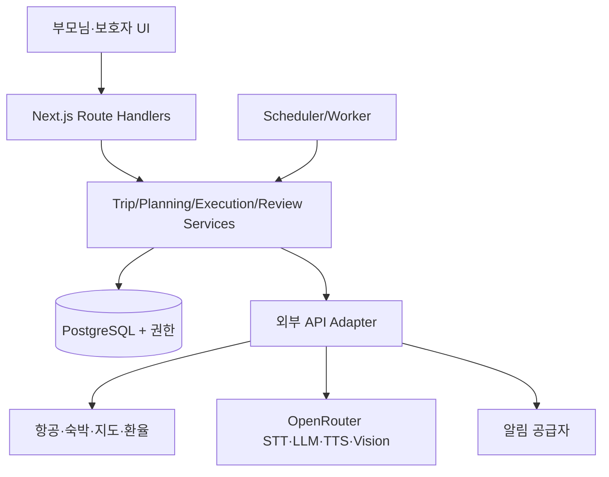

# easy-travel — Claude Code Opus용 전면 리뷰·MVP 개선 지시서

> 작성: 2026-10-31 (KST) · 검토 기준: `ani9085/easy-travel`, `main` 커밋 `caef1bc1bd3abce3e5405af797f4096520ab5015`  
> 대상: 부모님의 해외여행을 **계획 → 실행 → 회고**까지 도와주고 보호자가 필요한 범위에서 지원하는 모바일 우선 웹 앱  
> 성격: 저장소 코드 기반 현황 진단 + 권장 제품 설계 + Claude Code Opus에 전달할 실행 지시문  
> 주의: `현황 확인`과 `개선 제안(ChatGPT 의견)`을 구분한다. 웹 배포의 실제 동작, Vercel 환경변수 및 외부 API 계약은 직접 검증하지 않았다.

## 0. Claude Code에 바로 전달할 최상위 지시문

다음 지시를 읽고 **진단 → 우선순위 설계 → 작고 검증 가능한 구현 → 보고** 순서로 진행하라.

1. 대상은 `https://github.com/ani9085/easy-travel`이다. 먼저 `README.md`, `CLAUDE_HANDOFF_KO.md`, `EASY_TRAVEL_PRODUCT_MAP_KO.md`, `RESEARCH_BRIEF_KO.md`, `WORK_LOG_KO.md`, 그리고 전체 소스를 읽어라. 본 문서를 추가 요구사항 및 검수 계약으로 사용하라.
2. 기준 사용자는 **해외여행 중 스마트폰 조작이 익숙하지 않은 부모님(여행자)**이고, 준비/모니터링을 돕는 **자녀(보호자)**가 있다. 화면·권한·알림을 두 역할로 구분한다.
3. 제품의 중심은 **계획(항공 최저후보·숙박 연계·피로도 낮은 일정)**, **여행 중(오늘 해야 할 일·길찾기·사진 장소 찾기·상품 가격 판단·양방향 음성 통역·일정 진행 확인·자발적 숙소 도착 체크인)**, **회고(사진·지출·평가·다음 여행 학습)**의 끊김 없는 데이터 연결이다.
4. **데모는 데모로 표시**하라. 실제 항공가·호텔 재고·보호자 알림·안전 확인·시세를 확인하지 못했다면 연결된 것처럼 보이게 하지 마라. 실제 예약·결제·상시 추적·구조 요청은 이번 MVP에 포함하지 않는다.
5. **Phase 0/1부터 작업**하라. 먼저 코드·배포·보안·접근성에 대한 증거 있는 감사(Audit)와 새 아키텍처를 작성하고, 외부 유료 API·DB·사용자 계정 등 신규 선택 없이 수정 가능한 P0 결함 및 테스트를 작은 PR 단위로 구현하라. 서비스 계약이나 비용·개인정보를 수반하는 통합은 비교안과 질문을 제출한 후 승인을 받는다.
6. 기존 Next.js, Vercel, OpenRouter 연결을 최대한 재사용하라. 한 번에 프레임워크를 갈아엎지 말고 모듈형 모놀리스로 분리하고, 새 기능은 `Mock/Live` 어댑터를 명시적으로 구분한다.
7. 소스·브라우저 로그·커밋·PR에 API 키, 가족 전화번호, 여권, 예약번호 원문, 생체/위치 정보, 사진 원본을 남기지 마라. 인증·인증된 사용자별 사용량 제한·타임아웃·요금 상한을 검토하라.
8. 부모님 화면은 한국어 우선, 48px 이상 터치 영역, 큰 글씨, 고대비, 단계별 1개 주요 행동, 수동 대체 경로, 오프라인 핵심 정보가 있어야 한다. `390px/900px`, 실제 iOS Safari/Android Chrome에서 검증한다.
9. 코드를 바꾼 뒤 `npm run build`, 타입검사, 정적 분석, 자동 테스트, 주요 플로우 E2E, 모바일 화면·권한 거부·네트워크 실패 테스트를 수행하라. 도구가 없으면 실행하지 않은 항목을 정확하게 기재하라.
10. 사용자 승인 전 `main` 직접 push, 배포, 유료 API 활성화, DB 데이터 삭제·마이그레이션, 외부 문자 발송을 하지 마라. 기존 사용자 변경을 보존하고 작업 브랜치 및 검토 가능한 diff를 제공하라.
11. 산출물은 한국어로 `docs/AUDIT_KO.md`, `docs/ARCHITECTURE_KO.md`, `docs/PRODUCT_REQUIREMENTS_KO.md`, `docs/ROADMAP_KO.md`, `docs/TEST_PLAN_KO.md`, `docs/EXTERNAL_API_DECISIONS_KO.md`를 제안·작성하고, 구현된 기능에 맞춰 README 및 기존 인수인계 문서를 업데이트하라. 새 문서와 기존 문서의 중복은 정리하되 이력은 보존하라.
12. 첫 응답은 **(A) 현재 구현 확인표, (B) 발견된 결함 P0/P1/P2, (C) 데이터/화면/통합 설계, (D) 1차 PR 범위, (E) 외부 결정을 위한 질문 5개 이내**로 시작하라. 바로 모든 기능을 구현하겠다고 약속하지 마라.

---

## 1. 현재 저장소 조사 결과 — 사실 확인

| 항목 | 현재 코드에서 확인된 사실 | 관련 파일 |
|---|---|---|
| 스택 | Next.js `14.2.35`, React `18.3.1`, TypeScript `5.7.2` | `package.json` |
| 화면 | 약 860줄짜리 클라이언트 컴포넌트 1개에 여행 계획, 오늘, 환전, 통역, 사진, 안부, SOS 포함 | `app/page.tsx` |
| 서버 API | `POST /api/ai` 한 경로가 `translate`, `photo_location`, `itinerary_import`를 처리 | `app/api/ai/route.ts` |
| AI 연결 | OpenRouter 키는 서버 환경변수에서 읽음; 없으면 데모 문구, 오류 시 fallback | `app/api/ai/route.ts` |
| 계획 | 목적지/출발지/날짜/인원/예산 유형/선호, 일정 요약, 예상비, 항공 데모 3개 | `app/page.tsx` |
| 항공 모니터링 | ON/OFF와 시각만 브라우저에 저장. 실제 가격 수집·알림 없음 | `app/page.tsx`, `README.md` |
| 숙박 | 숙소명 수동 입력·‘호텔로 길찾기’는 있으나 숙박 검색/비교/추천 없음 | `app/page.tsx` |
| 지도 | Google Maps URL 외부 열기. 장소별 좌표/확인된 Place ID/실제 경로시간 저장 없음 | `app/page.tsx` |
| 번역 | **한국어 텍스트 → 현지어** 프롬프트. 마이크 녹음/현지어→한국어/음성 재생 기능 없음 | `app/api/ai/route.ts`, `app/page.tsx` |
| 사진 | 사용자가 선택해 전송한 사진으로 장소 후보를 AI가 추정. 현 위치 확인이나 상품 식별·시세 비교는 없음 | `app/page.tsx`, `app/api/ai/route.ts` |
| 환율 | Frankfurter/ECB 기준환율, 직접 입력 및 마지막 성공값 참고 계산 | `app/page.tsx` |
| 가족 공유 | 복사 링크 `/family/{code}` 생성, 계정/권한/공유 페이지 없음 | `app/page.tsx` |
| 안부·SOS | 수동 GPS 요청 후 해당 기기에 기록/표시. 보호자 발송·숙소 체크인·자동 알림 없음 | `app/page.tsx` |
| 영속성 | `localStorage` (`easy-travel-demo`, `easy-travel-planning`, `easy-travel-rates`); DB 없음 | `app/page.tsx` |
| 테스트/배포 | 저장소에는 자동 테스트·CI·락파일이 보이지 않음. README/인수인계 문서는 Vercel 실배포를 아직 미완료라고 적음. 현재 GitHub 홈에는 Vercel 주소가 등록되어 있으므로 **운영 상태 재확인 필수** | 파일 목록, README, GitHub 메타데이터 |

**주의:** 위 표는 GitHub `main`의 파일을 읽어 확인한 내용이다. 작동 여부를 실제 스마트폰·프로덕션에서 재현했다는 뜻은 아니다.

### P0 — 먼저 바로잡을 문제 (코드 근거)

1. **현재 여행과 ‘오늘’ 화면 불일치:** `starterPlaces`가 파리 장소이고 `hero-meta`에 `10월 18–22일 / 가족 3명`이 하드코딩되어 있다. 계획을 도쿄로 바꾸어도 장소·호텔·날짜가 자동 연동되지 않는다. `Trip` 단일 데이터 모델과 활성 여행 선택이 필요하다.
2. **가족 링크 오인 위험:** `/family/{code}` 형태의 링크를 복사하지만 실제 라우트/권한/실시간 DB가 없다. 미구현이면 링크 대신 ‘가족 공유 준비 중’으로 명확히 안내한다.
3. **모니터링 오인 위험:** 현재 가격 감시는 단순 boolean이고, 클릭 시 “모니터링 시작”이 표시된다. 실제 알림과 분리하거나 기능 이름을 ‘감시 설정 데모’로 바꾼다.
4. **부정확한 날짜 검증:** 귀국일이 출발일보다 빠른 입력 등에서 잘못된 여행일수가 생성될 수 있다. 계획 단계에 유효성 검사 및 시차/현지 날짜 처리가 필요하다.
5. **안전 신호 오인 위험:** `checkIn()`은 좌표 문자열을 화면 문구에 넣지만 `lastCheckin` 시간만 보존하고 보호자에게 아무것도 보내지 않는다. ‘안전하게 도착’ 판정을 자동으로 하지 않는다.
6. **AI 호출 비용 보호 부족:** 공개 `/api/ai`에는 사용자 인증/요청별 사용량 제한/원가 제한/명시적 상위 API 타임아웃이 보이지 않는다. OpenRouter를 실제로 쓰는 공개 배포라면 우선 보호해야 한다.

### P1 — 핵심 고객가치 부족

1. 항공권·호텔은 연동된 가격/날짜/수하물/환불/위치/이동 부담을 함께 비교하지 못한다.
2. 추천 일정은 고정 템플릿이며 장소 영업시간·이동시간·휴식·체력·우천·시차를 반영하지 않는다.
3. 항공 도착시간 및 공항에서 숙소까지 이동과 숙소 체크인 가능시간이 연결되지 않는다.
4. 양방향 음성 통역 및 큰 글씨 결과/음성 재생이 없다.
5. 사진의 OCR·GPS·지도 후보 결합, 상품 정확한 식별·가격 근거가 없다.
6. 일정의 ‘계획/진행/완료/건너뜀/지연’ 상태가 없고, 숙소 도착 체크인과 보호자 수신 확인이 없다.
7. 오프라인 일정·주소·예약 요약의 안정적인 읽기 경로가 없다.
8. 귀가 후 사진·비용·평가·공유를 통한 회고 흐름이 없다.

### P2 — 유지보수·품질

- `app/page.tsx`의 상태/이벤트/DOM/UI가 결합되어 변경 영향이 크다.
- 브라우저 데모 저장소와 진짜 여행 데이터의 구분/마이그레이션 전략이 없다.
- 프롬프트 결과가 구조화된 계약으로 검증되지 않는다. 특히 `itinerary_import` 서버 작업은 현재 화면에서 직접 연결되지 않는다.
- 초기 프랑스어 예문과 파리 기본값은 실제 방문 국가에 맞춰 바뀌지 않는다.
- API 통신 오류, 이미지 포맷, 마이크 미지원, GPS 거부, 저속/해외 데이터망, 가격 유효기간을 체계적으로 테스트해야 한다.
- 로그/에러 분류/측정, 자동화된 회귀 테스트와 배포 후 스모크 테스트가 필요하다.

---

## 2. 제품 원칙과 사용자 경험

### 핵심 구분

- **보호자 모드**: 여행 조건·항공/호텔 비교·동선 편집·예산·가족 초대·가격 알림 설정·회고 정리.
- **부모님 모드**: 딱 지금 할 일, 다음 장소, 큰 길찾기 버튼, 사진·음성 번역, 가격 계산, ‘숙소 도착 알리기’, 연락처/SOS.
- 동일한 `Trip`과 일정/예약 자료를 공유하되, 보호자가 올린 제안은 여행자 승인 전 자동으로 일정에 적용되지 않는다.
- 첫 화면은 현재 여행 상태를 인식한다: `여행 전`, `오늘 출발`, `여행 중`, `귀가`, `회고`.
- ‘시세’, ‘최저’, ‘안전’ 같은 강한 단어는 반드시 근거와 기능 범위를 곁들인다.

### 화면 IA 제안 (ChatGPT 의견)

```text
여행자 홈
 ├─ 지금 할 일 · 다음 이동 · 호텔로 돌아가기
 ├─ 여행 일정 [오늘 / 전체]
 ├─ 카메라 [여기 어디? / 이 물건 얼마? / 영수증]
 ├─ 통역 [한국어→현지어 / 현지어→한국어]
 ├─ 가격 계산 [현지통화→KRW / 시세 비교]
 └─ 안부 [숙소 도착 알리기 / 보호자 연락 / 긴급전화]

보호자 홈
 ├─ 여행 만들기·비교 [항공 / 숙박 / 일정 / 예산]
 ├─ 가격 감시 [조건 / 조회 이력 / 알림]
 ├─ 예약 준비·문서
 ├─ 가족 초대·공유 권한
 ├─ 여행 현황 [동의된 마지막 체크인 / 미확인 상태]
 └─ 회고 [사진 / 실제 비용 / 평가 / 다음 여행]
```

### 접근성 검수

큰 글씨/실제 손가락 터치/느린 데이터망/고대비/VoiceOver·TalkBack/오류 후 복귀/확인 동작을 검수한다. 중요 버튼은 아이콘+텍스트를 함께 사용한다. 결과를 읽기 어렵다면 음성으로 들려주되, ‘오디오 재생’도 사용자가 누를 때만 시작한다. 카메라·마이크·위치·푸시 권한은 각각 필요한 시점에 별도 설명과 동의를 받는다.

---

## 3. 계획 단계 상세 요구사항

### PL-01. 여행 조건 수집

필수: 출발 공항(IATA 코드), 목적지(도시/공항 코드), 날짜 혹은 날짜 범위, 성인·아동 수, 전체 예산(KRW), 여행 기간, 직항/경유 허용.  
부모님 친화 옵션: 하루 최대 걷기 시간/거리, 계단 회피, 짐의 양, 이동수단 선호, 휴식 빈도, 식사/관광 관심, 다국어 어려움, 출발 시간대, 숙박 조식·엘리베이터·교통 접근성. 건강/장애 관련 민감한 설명의 수집은 꼭 필요한 경우와 동의를 구분하라.

### PL-02. 항공권 탐색·비교

사용자가 검색을 누르면 공급자 어댑터로 `FlightSearchRequest`를 보낸다. 최소 반환 필드:

```ts
type FlightOffer = {
  id: string; provider: string; sourceUrl?: string; fetchedAt: string;
  originIata: string; destinationIata: string;
  departLocal: string; arriveLocal: string; returnDepartLocal?: string; returnArriveLocal?: string;
  outboundDurationMinutes: number; returnDurationMinutes?: number;
  stops: number; transferAirports: string[]; connectionMinutes?: number[];
  airlineNames: string[]; cabin: string; checkedBaggage?: string;
  totalPrice: number; currency: string; taxesIncluded?: boolean;
  fareRules?: { changes?: string; refunds?: string };
  offerExpiresAt?: string; dataMode: "mock" | "live";
};
```

‘최저가’ 정렬 외에 **직항 추천**, **이동 피로도 최소**, **오전/오후 적절한 출발**, **수하물 포함 실지불 총액**을 비교한다. 목적지가 같더라도 도착 공항·현지 도착일·공항 이동비를 같이 본다. 항공권과 호텔을 묶어 `항공+숙박+공항 왕복 교통 예상액` 총예산을 비교한다.

주의: 사용자가 본 특정 공급자·검색 조건의 조회 시점 최저후보만 표시하고 **시장 전체 ‘진짜 최저가’ 보장 금지**. 재조회/예약 페이지에서는 가격·재고가 달라질 수 있다.

### PL-03. 항공 가격 모니터링

- 검색 결과를 저장하는 것과 실제 가격 감시 작업 등록을 분리한다.
- 사용자가 기준 조건(노선, 왕복일/유연한 범위, 인원, 경유, 수하물, 예산 또는 목표가, 수신 채널, 만료일)을 확인하고 `활성화`해야 한다.
- 저장 필드: `searchCriteriaHash`, `provider`, `status`, `targetPrice`, `bestSeenPrice`, `lastCheckedAt`, `nextCheckAt`, `lastErrorAt`, `notificationStatus`, `consentVersion`.
- 같은 노선·인원·조건의 이력을 비교하되 세금/수하물/통화/좌석이 다른 가격은 같은 것으로 취급하지 않는다.
- 트리거 예시(정책 제안): `사용자 목표가 이하`, `최근 비교 가능한 조회값보다 10% 하락`, `직항이 예산 범위에 진입`. ‘10%’는 초기 기본값 제안이며 사용자가 변경할 수 있어야 한다.
- 중복 알림 제한, 요청 비용 상한, 가격 API 호출 실패 재시도, stale 표시, 작업 일시정지·삭제·만료, 알림 전달 실패와 읽음 구분.
- **공급자 사용 약관 검증이 가장 먼저다.** 자동 조회를 금지하는 검색 API를 정기 크롤링하거나 자동 호출하지 않는다. 가격 감시용 라이선스/공식 스케줄 데이터가 없으면 실제 감시 버튼을 비활성화하고 사용자가 직접 재검색하도록 한다.

### PL-04. 항공 스케줄과 연동한 호텔 추천

입력: 항공 도착·출발 현지시각, 체크인·체크아웃 날짜, 인원/객실, 예산, 주요 방문지/역, 엘리베이터·에어컨·조식·취소 가능 여부.  
출력: 호텔별 `실제 총숙박비(세금/수수료 명시)`, `체크인 시간`, `공항에서 이동 소요(조회 근거)`, `주요 일정 접근성`, `걸음 부담`, `환불/취소 조건`, `근처 교통`, `후기 출처/시각` 및 예약처 링크.

추천 패키지는 예를 들어 아래 3개로 분리한다.

1. **편안한 이동:** 늦게 도착하면 공항 접근성 및 프런트 운영/늦은 체크인 가능 여부를 우선.
2. **이동 부담 적음:** 일정의 중심 장소와 기차역/정류장에서의 이동 부담을 우선.
3. **예산 절감:** 요금+교통비 총액을 우선. 저가라도 계단·장거리 걷기 문제를 경고.

동일 호텔이라도 취소 가능/불가, 식사 포함, 객실/침대, 세금 포함 상태가 다르면 별도 옵션으로 표시한다. 호텔 데이터가 없으면 **‘예시/조건 기반 추천’**으로 표시하고 실제 재고·가격처럼 보이게 하지 않는다.

### PL-05. 실행 가능한 일정 생성

일정 데이터는 관광지 문자열이 아니라 `날짜·현지 시간대·좌표/Place ID·체류 예상·이동모드·이동시간·예약 필요·식사·휴식·대체안·확정 상태`를 가져야 한다. 첫날에는 항공 도착/수하물/입국/호텔 이동/체크인 시간을 고려하고 마지막 날에는 공항 권장 도착 시간을 반영한다. **지도 이동시간 미연동 시 AI가 임의로 ‘25분’ 등 정밀 수치를 만들어내면 안 된다.**

부모님을 위한 하루 기본값 제안: 핵심 장소 2곳 이하, 점심 및 휴식 블록, 장시간 대기·계단 회피, 동선 역주행 최소화, 비 오는 날 실내 대체안. 이 기본값들은 추후 사용자별로 변경 가능하도록 설계한다.

### PL-06. 예산/문서/가족 확정

항공·숙박·공항 교통·현지 교통·식비·관광·쇼핑 예비비를 각각 계산하고, `확정 예약금액`과 `추정 금액`을 구분한다. 예약 정보는 원본 업로드 최소화, 번호 일부 마스킹, 만료·삭제 지원. 여행 계획 PDF/공유 링크는 공개 무작위 코드 하나만으로 접근되지 않게 인증·만료·공유 범위를 정한다. 가격/동선/예약 추천은 사용자가 선택한 뒤에만 `confirmed`로 바뀐다.

---

## 4. 여행 실행 단계 상세 요구사항

### EX-01. ‘지금 무엇을 해야 하나?’ 대시보드

활성 여행과 **현지 날짜·시간대**로 오늘 일정을 선택한다. 현재 시각/사용자 표시 상태를 기준으로 `지금`, `다음`, `완료`, `지연 가능`, `건너뜀`, `변경 제안`을 보여준다. 가장 큰 버튼은 `다음 장소 길찾기`; 하단에는 `숙소로 돌아가기`, `통역`, `안부 알리기`.

일정 비교는 두 층으로 구분한다.

- **기본 MVP(권장):** 사용자가 출발/도착/완료를 누르는 상태 기록 + 선택적 일회성 GPS 위치 비교. 조용히 추적하지 않는다.
- **후속:** 사용자 동의하에 앱이 켜져 있을 때만 현재 좌표와 계획 POI 거리를 비교하고, 일정 지연 시 ‘일정을 바꿀까요?’라고 제안. 좌표 정확도/도착 반경 불확실 시 사용자가 직접 확인.

시간 지연=위험 또는 이탈=위험으로 표시하지 않는다. GPS 미허용/오류/해외망 부재일 때도 수동 완료가 가능해야 한다.

### EX-02. 사진으로 장소 찾기 (‘여기 어디?’)

1. 카메라를 켜거나 사진을 고른다. 외부 AI 분석 전 사진·위치 정보 전송 범위/동의를 안내한다.
2. 이미지 OCR(간판·도로 표지·메뉴), 랜드마크 시각 추정, 선택 시 **현재 GPS 주변 POI 후보**를 조합한다.
3. `장소 후보 1~3개`, `후보인 이유`, `정확도 낮음/확인 필요`, `지도에서 보기`, `여기까지 길찾기`를 제공한다.
4. 사진만으로 정확한 GPS 좌표를 알 수 없다고 알리고, 현 GPS가 없는 경우 추정 장소명만 표시한다. 주변 후보와 충돌하면 ‘이곳인지 확인해 주세요’로 제시한다.
5. 얼굴/차량번호/민감정보 흐림 옵션, 1280px 축소·EXIF 제거(현 코드 장점 유지), 서버 저장 기본 꺼짐, 실패 시 간판 직접 입력.

### EX-03. 사진으로 상품·가격 확인 (‘이 물건 비싸?’)

입력: 상품 사진, 가격표/영수증 사진, 바코드(가능하면), 통화, 수량·용량, 브랜드/모델.  
처리: `이미지→OCR/상품 식별→상품 후보 사용자 확인→현지 표시가 숫자/통화 분리→환율 변환→동일 상품·용량·조건의 비교가격 조회→근거 평가`.

화면에 **세 값을 분리**한다.

1. `현재 표시 가격`: 예: `€25.00` (읽은 가격표는 사용자 확인 필요).
2. `한화 참고금액`: 예: `약 ₩XX,XXX` (환율 기준일·출처·카드 수수료 제외 안내).
3. `현지 시세 판단`: 확인된 비교 매장/날짜/동일 제품의 유효 자료가 있을 때만 `상대적으로 저렴/비슷/비쌈` 제시. 출처가 없거나 용량·세금·판매조건이 다르면 **‘판단할 자료가 부족해요’**라고 표시.

가격 비교는 상품 자체의 모델/바코드와 동일 용량, 세금 포함, 할인조건, 지역 차이, 면세/일반, 환불 가능 여부를 정규화한다. 네트워크 없이 이미지만으로 **현지 시세를 생성하지 않는다**. 공급자 API가 확정되기 전에는 환전+식별+직접 비교 링크까지만 제공한다. 한국 가격 비교는 별도 선택 기능(동일 모델 및 공식 세금/관부가세 차이 표기)으로 둔다.

### EX-04. 양방향 음성 통역

보호자/부모님이 별도 설정 없이 고를 수 있도록 큰 버튼 두 개:

- `🎙️ 한국어로 말하기 → 현지어로 보여주고 읽어주기`
- `🎙️ 현지 사람 말 듣기 → 한국어로 보여주고 읽어주기`

기본 흐름: `버튼 눌러 녹음 시작 → 녹음 중 표지 → 종료 → STT 원문 검토 → 번역 → 원문/번역문 큰 글씨 표시 → 사용자가 재생 버튼 누르면 TTS → 다시 듣기/수정`.

- 대상 언어는 여행 국가에서 제안하되 사람이 직접 변경할 수 있다(예: 일본의 한국어↔일본어). 자동 언어 감지는 불확실하면 사용자 확인.
- 초기에는 짧은 문장/발화 턴 단위로 구현. 상시 마이크 켜짐·실시간 스트리밍 통역은 이후 비용/지연 테스트를 거쳐 검토.
- 여행 문맥 프롬프트는 **뜻 보존, 공손함, 간결함, 불확실한 고유명사 확인**, 의학·법률·응급 상황에 과도한 신뢰 금지.
- 통역 결과에 `원문`, `번역문`, `언어`, `입력 방법`, `AI/데모`, `재생 가능한지`를 표시. 음성 녹음은 기본 보관하지 않는다.
- 비용 절감을 위해 브라우저 Web Speech 가능 여부를 런타임 감지하되 iOS Safari/Android Chrome 실제 테스트 필요. 서버 STT/TTS는 현 OpenRouter의 전용 API를 사용할 수 있지만 모델/언어 지원, 권한, 요금, 데이터 처리정책을 검증한다.
- 마이크 거부/잡음/오인식/느린 데이터망/서버 장애 때는 텍스트 입력 및 자주 쓰는 문장으로 돌아간다.

### EX-05. 일정 준수 확인·재계획

각 `ItineraryItem` 상태를 `planned | in_progress | arrived | completed | skipped | delayed`로 기록한다. 지도는 Google Maps URL부터 시작하고, 자동 ETA/경로 비교는 별도 지도 API를 붙인 뒤에만 표시한다. 부모님이 30분 늦게 출발한 경우 ‘다음 장소를 뒤로 미루거나 오늘 생략할까요?’를 보여주고, 변경은 사용자 확정 뒤 가족에게 공유한다. 유료 공급자 호출이 없는 상태에서 실시간 교통시간을 꾸며내지 않는다.

### EX-06. ‘숙소 도착 알리기’·안부·보호자 확인

사용자는 `숙소에 도착했어요` 버튼을 누른다. 위치 권한을 선택적으로 요청하고, 숙소 좌표와 위치 오차를 참고하여 **‘숙소 근처에서 확인됨’ 또는 ‘위치 미확인’**을 나누며, 결국 **사용자 확인 사실**을 서버에 기록한다.

상태 흐름 예시:

```text
체크인 예정 → 여행자가 ‘도착했어요’ 선택
  → 서버 기록 성공/실패 표시 → 보호자 알림 전송 시도
  → 발송 성공/실패 별도 표시 → 보호자가 읽음 확인(선택)
```

- 당초 공유받은 일정과 예상 도착시간에 맞춰 사전 동의한 **확인 요청**만 보낸다. 미응답은 `미확인`으로 표시하고, `위험/실종/안전 이상`으로 자동 단정하지 않는다.
- ‘호텔 안전 도착’이라는 단정 대신 `OO님이 HH:MM에 숙소 도착을 직접 알렸어요`, `위치 정보 미제공`, `알림 전송 실패` 등으로 정확히 표현한다.
- 카카오톡/문자/이메일/웹 푸시는 **실제 발송 공급자/인증/동의/수신 확인/실패 추적이 준비된 채널만** 사용한다. `tel:`은 구조기관 통화 성공을 보장하지 않는다.
- 위치는 기본 비공개, 체크인 시 1회 공유부터 구현. 상시 백그라운드 추적은 별도 앱·권한·정책 검토 없이는 하지 않는다.
- SOS는 사용자에게 먼저 현지 긴급전화 안내, 이어 보호자 연락 옵션. 전송 성공 전까지 ‘구조 요청 완료’ 문구 금지.

### EX-07. 오프라인 필수 정보

여행 중 데이터를 못 쓸 경우에도 읽을 수 있어야 하는 것: 오늘/내일 일정, 호텔 이름·주소·현지어 표기, 긴급번호, 가족 연락처, 예약 핵심 요약(민감번호 마스킹), 자주 쓰는 문장, 마지막 동기화 시각. PWA 캐시/IndexedDB는 용량·갱신·암호화/공유 기기 주의가 필요하다. 웹앱을 닫았을 때 정확한 위치·알림 동작을 약속하지 않는다.

---

## 5. 귀가 후 리뷰 단계 요구사항

### RV-01. 여행 타임라인

일정 `완료/건너뜀` 기록과 **사용자가 선택해 추가한** 사진·한 줄 소감을 날짜별로 연결한다. 자동 사진첩 전체 접근 금지. 사진 메타데이터에서 위치를 쓰려면 별도 동의와 확인 절차가 필요하다.

### RV-02. 실제 비용과 예산 차이

영수증 촬영·OCR 또는 직접 입력 → `상호/일시/금액/통화/분류` 미확정 후보 → 여행자가 수정·확정 → 예산 대비 실제값·통화별 참고 환율 표시. 환전율(참고)과 카드 승인 실제 원화금액이 다를 수 있음을 분리. 사용자 확인 없는 자동 기록 금지.

### RV-03. 여행 평가와 다음 여행 개선

여행 편의성, 걷는 양, 호텔 접근성, 통역 사용성, 비용 만족도를 각각 1~5점 또는 쉬운 선택형으로 묻는다. ‘다음에는 직항/엘리베이터 있는 호텔/중간 휴식 증가’ 같은 선호는 **사용자 승인 후** 다음 계획 기본값에 제안으로 저장한다. 위치·사진을 학습용으로 무단 활용하지 않는다.

### RV-04. 공유형 여행 요약

한 페이지 요약/PDF: 일정 요약, 선택 사진, 주요 이동, 지출 총액, 인상 깊었던 장소, 다음 개선점. 보호자에게 사진·비용을 보여주기 전 공유 범위를 확인한다.

---

## 6. 권장 기술 구조 (ChatGPT 의견)

**현재 Next.js/Vercel을 유지하는 모듈형 모놀리스**를 권장한다. DB/인증은 공급자 한 곳을 일단 선정하되 도메인은 특정 업체 SDK에 묶지 않는다.



### 폴더 제안

```text
app/
  (traveler)/today, itinerary, camera, interpreter, safety
  (guardian)/planning, compare, monitor, family, review
  api/trips, flights/search, hotels/search, monitors, checkins, ai, notifications
components/
  common, traveler, guardian, planning, execution, review
lib/
  domain/trip, itinerary, offer, booking, checkin, expense, consent
  services/planning, navigation, interpretation, safety, review
  integrations/flights, hotels, maps, fx, vision, stt, tts, notification
  db, auth, validation, observability, rate-limit
tests/
  unit, integration, e2e, fixtures
docs/
  AUDIT_KO.md, ARCHITECTURE_KO.md, PRODUCT_REQUIREMENTS_KO.md,
  ROADMAP_KO.md, TEST_PLAN_KO.md, EXTERNAL_API_DECISIONS_KO.md
```

### 데이터 모델 권장

| 엔터티 | 주요 필드/관계 | 중요 제약 |
|---|---|---|
| `User` | id, role, preferredLanguage, settings | 인증 제공자 ID와 역할 분리 |
| `Trip` | id, creator, destination, timezone, dateRange, state | 여행자별 활성 여행, 권한 검사 |
| `TripMember` | tripId, userId, role, inviteStatus, consent | 초대 만료/철회/최소권한 |
| `TravelPreference` | tripId, walkingLimit, pace, transfer, hotelAmenities | 민감정보 최소수집 |
| `TravelSearch` | criteria, provider, mode, checkedAt | Mock/Live 분리 |
| `FlightOffer` / `HotelOffer` | total, currency, taxes, rules, source, fetchedAt, expiry | 스냅샷 불변, stale 구분 |
| `PriceWatch` / `PriceObservation` | criteriaHash, target, status, observedPrice, source | 약관 준수/중복 방지 |
| `ItineraryDay` / `ItineraryItem` | localDate, localTime, placeId/coords, state, duration, version | 확정 전 수정·승인 |
| `Reservation` | bookingType, maskedRef, date, attachments | 선택 접근/암호화/보관 기한 |
| `CheckinEvent` | tripId, type, userConfirmedAt, optionalLocation, accuracy, deliveryStatus | ‘수신 확인’과 ‘안전’ 구별 |
| `TranslationSession` | from/toLanguage, inputMethod, optionalText, consent | 녹음 기본 저장하지 않음 |
| `PriceComparison` | itemIdentity, unit, observedLocalPrice, comparisons, rateRef, confidence | 근거 없는 시세 금지 |
| `Expense` | amount, currency, convertedReference, confirmedBy, receiptId | 추출/확정 상태 분리 |
| `TripReview` | tripId, ratings, selectedPhotos, nextTripPreferenceDraft | 공유 범위 승인 |
| `NotificationAttempt` | channel, eventId, idempotencyKey, queuedAt, sentAt, failedAt | 발송/수신/읽음 상태 분리 |

### 주요 상태 계약

- Trip: `draft → comparing → planned → booked → upcoming → in_progress → returned → reviewing → archived`.
- Search: `idle → loading → partial → ready | empty | stale | error`.
- AI 결과: `uploaded/recorded → processing → candidate → user_confirmed | rejected`.
- 체크인: `requested → user_confirmed → server_recorded → notification_queued → delivered/failed`(실제 공급자 의미에 맞게 세분화).
- 가격 감시: `draft → active → paused → expired`, 공급자 오류는 별도 하위 상태.

### API·보안 계약

1. 모든 입력은 스키마로 검증하고 출력도 구조화 검증. 본문 바이트 제한, 모델별 허용 MIME/이미지 크기/오디오 길이 제한, 상위 호출 타임아웃, 오류 상태, 429 처리, circuit breaker 제안.
2. OpenRouter API 키와 항공·호텔·알림 키는 서버 환경변수만. 외부 공급자에게 보내는 텍스트/사진/오디오·공유 데이터를 목적별로 최소화. 요청 본문 원문 로깅 금지.
3. 인증된 사용자별 및 IP별 rate limit, 일일 과금 상한, 고비용 모델 별도 제한, 감사 로그(개인정보 제외), abuse 방어.
4. DB는 서버 권한 정책과 소유권 검증. `TripMember` 철회 즉시 적용. 사용자가 첨부/개인정보 삭제 및 내보내기를 요청할 경로 설계.
5. 가격/환율/위치 응답에는 `source`, `asOf/checkedAt`, `dataMode`, `confidence`, `limitations`. UI는 이 필드를 지우지 않는다.
6. 지오로케이션은 브라우저 권한과 HTTPS를 전제로 하고, 위치 정확도/취득 시각을 함께 평가. 수신 실패는 미확인이다.
7. 캐시/작업 큐/크론은 배포 플랫폼 제약과 데이터 변경의 idempotency를 고려한다. Vercel Hobby라면 분 단위 알림을 제품 약속으로 내걸지 않는다.

---

## 7. 외부 API 후보·결정 기준

**확정 사실(공식 문서):**

| 영역 | 후보 | 공식 문서로 확인된 특징 | 구현 시 필수 확인 |
|---|---|---|---|
| 항공 검색 | Skyscanner Flights Live Prices | 노선·날짜의 항공 가격 검색; 비동기 create/poll | 파트너 승인 필요. **사용자 클릭 없는 자동 Live Pricing 호출을 금지하는 이용 지침**이 있어 무단 감시용으로 사용하면 안 됨 |
| 유연한 날짜 | Skyscanner Indicative Prices | 날짜/목적지 미정 탐색용 참고 가격 | 과거/캐시 가격이며 예약 가능 실시간 가격과 구분 |
| 호텔 | Skyscanner Stays Live Prices | 날짜·위치·인원에 따른 숙박 후보·옵션 | 파트너 접근·로고/링크·가격 표시 계약, 실제 재고 차이 |
| 항공/호텔 대안 | Duffel Flights / Stays | 항공 제안 요청, 숙박 검색 API 문서 제공 | Stays 별도 access 신청, 상품 판매 전제/비용/국내 노선 커버리지 |
| AI 음성 | OpenRouter Transcriptions / Speech | `/api/v1/audio/transcriptions`, `/api/v1/audio/speech` 및 기존 텍스트/비전과 같은 키 | STT/TTS 모델별 언어/형식/가격/보존 정책·브라우저 녹음 테스트 |
| 간단 길찾기 | Google Maps URLs | URL 기반 Maps 검색/길찾기 앱 열기, 별도 API 키 불필요 | 정확한 Place ID·좌표/ETA가 필요하면 별도 Places/Routes API |
| 환율 | ECB 참고율 / Frankfurter | 기준환율 참고 | 실결제 카드 환율·수수료 아님, 일부 통화 미지원 |
| 가격 감시 실행 | Vercel Cron | Hobby는 문서상 **하루 1회**, 약속 시각 정확성 제한 | 필요한 빈도/요금제/별도 작업자/중복 실행 처리 |
| 상품 시세 | **미선정** | 현재 신뢰 가능한 현지 동일 상품 가격 제공자를 확인하지 못함 | 국가별 데이터 권리, 상품 동등성, 업데이트 시각, 환율·세금 정규화 |
| 가족 알림 | **미선정** | 현재 코드에 전송 서비스 없음 | 채널 승인, 동의, 발송 성공/실패/수신/읽음의 구분 |

**ChatGPT 의견:** 가장 먼저 항공·숙박 공급자 두 개를 실제 가입 가능성/파트너 심사/노선 커버리지/크론 사용 허용/요금/예약 링크/사용자 전환 제한을 기준으로 비교하는 1~2일짜리 Spike를 진행하라. 공급자 선정 전까지 `MockFlightProvider`, `MockHotelProvider`, `MockPriceWatchProvider`를 분리하고 테스트 데이터에 눈에 띄는 ‘데모’ 레이블을 붙여라.

공식 출처:

- Skyscanner API 인증·승인: https://developers.skyscanner.net/docs/getting-started/authentication
- Skyscanner Live Pricing 이용 지침: https://developers.skyscanner.net/docs/getting-started/usage-guidelines
- Skyscanner Live Prices: https://developers.skyscanner.net/docs/flights-live-prices/overview
- Skyscanner Indicative Prices: https://developers.skyscanner.net/docs/flights-indicative-prices/overview
- Skyscanner 호텔 Live Prices: https://developers.skyscanner.net/docs/hotels-live-prices/overview
- Duffel 항공: https://duffel.com/docs/guides/getting-started-with-flights
- Duffel 숙박: https://duffel.com/docs/guides/getting-started-with-stays
- OpenRouter STT: https://openrouter.ai/blog/tutorials/transcription-on-openrouter/
- OpenRouter STT/TTS: https://openrouter.ai/blog/announcements/announcing-audio-apis/
- Google Maps URLs: https://developers.google.com/maps/documentation/urls/get-started
- Web Speech API: https://developer.mozilla.org/en-US/docs/Web/API/Web_Speech_API/Using_the_Web_Speech_API
- Vercel Cron 이용량: https://vercel.com/docs/cron-jobs/usage-and-pricing

---

## 8. 개발 단계·PR 단위 (권고)

| 단계 | 목표 | 구현/문서 | 종료 조건 |
|---|---|---|---|
| **0. 감사/안정화** | 현재 실구현/문서/배포 정합성, P0 해결 | Audit, 테스트 기초, 오인 문구 수정, 날짜 검증, 가짜 링크 비활성화, OpenRouter 비용 제한 설계 | 빌드+기본 테스트, 데이터·안전 기능에 허위 문구 0 |
| **1. 도메인/화면 분리** | 여행 데이터 단일화 | Trip/Itinerary 타입, 역할별 라우트·컴포넌트, localStorage 버전 마이그레이션 | 장소·호텔·날짜가 동일 활성 여행에서 연동 |
| **2. 계획 품질 MVP** | 항공+숙박+일정+예산 | Mock Flight/Hotel Adapter, 연계 정렬, 휴식 일정, 공급자 계약 | 5분 내 계획 생성/수정/저장, 전체 비용·근거 표시 |
| **3. 서버 공유 기반** | 보호자와 실제 공유 | 인증, DB, 초대/철회, 체크인, 역할·공유범위 | 타 기기에서 동일 여행 접근, 미승인 사용자 접근 거부 |
| **4. 실데이터·알림** | 1개 항공/호텔 공급자, 모니터링/가족 알림 | 공식 계약/키, 스케줄러, 재시도, 전송/조회 로그 | 동일 조건 가격/근거 표시, 알림 전달 실패 처리 |
| **5. 여행 실행 기능** | 부모님 실사용 | 양방향 STT→번역→TTS, 사진 장소 후보+지도, 상품 환전/비교, 일정 상태/숙소 체크인 | 권한 거부·오프라인·저속망 대체 경로 포함 |
| **6. 회고/마무리** | 여행 경험의 재사용 | 영수증 후보 확인, 리뷰/사진 타임라인, 요약/PDF, 사용성 테스트 | 사용자가 비용·사진 공유 범위 직접 확정 |

각 단계는 PR로 쪼갠다. 예: `PR-01 baseline test & README`, `PR-02 trip data model`, `PR-03 planning adapters`, `PR-04 hotel+flight bundles` 등. 실행순서는 의존성에 따라 조정 가능하나 개인정보/알림은 동의·인증 설계 없이 앞당기지 않는다.

**단기 2주 MVP 목표(ChatGPT 의견):** 단계 0, 1, 2의 **Mock 기반 고품질 계획 기능**까지 우선 완료, 단계 5에서는 텍스트 기반 양방향 통역과 수동 숙소 체크인의 UI/테스트를 이어서 준비. 실제 공급자 키 및 데이터가 확인되면 단계 4를 별도 일정으로 잡는다. 2주는 인력/개발 속도를 모르는 추정이지 일정 보장이 아니다.

---

## 9. 필수 검수 시나리오 (Given/When/Then)

| ID | 입력/상황 | 반드시 확인할 결과 |
|---|---|---|
| T01 | 도쿄로 계획을 바꾸고 여행 활성화 | ‘오늘/호텔/일정/통화/언어’가 이전 파리 데모 값으로 남지 않음 |
| T02 | 귀국일이 출발일보다 이른 경우 | 저장·검색 전에 이해하기 쉬운 오류, 1일 여행으로 덮어쓰기 금지 |
| T03 | 항공 API 키 없음·API 실패 | ‘데모/조회 실패/마지막 조회’ 구분, 허위 최저가·새 가격 알림 없음 |
| T04 | 직항 고가 vs 경유 저가, 늦은 도착 | 항공+호텔+공항 이동을 비교, 가격순/편안함순의 근거 보여줌 |
| T05 | 호텔 체크인 시간보다 도착이 늦은 항공 | 늦은 체크인 가능 여부 확인 필요 표시, 확인 없으면 보장 문구 없음 |
| T06 | 부모님 iOS Safari에서 마이크 권한 거부 | 녹음 포기 후 텍스트 번역과 자주 쓰는 말 사용 가능 |
| T07 | 일본어 발화를 STT로 입력 | 일본어 원문·한국어 번역·재생, 번역 방향을 바꾸면 역방향 결과 |
| T08 | 외국 유명 건물 사진, GPS 거부 | 장소 후보/낮은 확신도/지도 검색, ‘현재 좌표 확인’이라고 단정 금지 |
| T09 | 상품 사진에 `€25`만 있음 | 원화 참고금액은 산출 가능해도 현지 시세 자료 없으면 ‘판단 불가’ |
| T10 | 같은 상품의 용량·세금 포함 여부가 다른 가격 | 단순 가격 비교 결과 확정하지 않고 조건 차이 표시 |
| T11 | 부모님이 ‘숙소 도착’ 누르고 알림 전송 실패 | 사용자 체크인 저장과 알림 실패가 분리되어 표시, ‘가족이 확인함’ 금지 |
| T12 | 보호자가 체크인 예정시간 후에도 아무 기록을 못 받음 | ‘안부 미확인/연락 권장’이지 ‘위험 발생’이 아님 |
| T13 | 휴대폰 오프라인 | 이전 동기화된 숙소 주소·일정·긴급번호를 볼 수 있음, 최신성 표기 |
| T14 | 외부 사용자가 다른 가족 코드 추측 | 인증/멤버 권한 없으면 일정·체크인·사진에 접근 불가 |
| T15 | OpenRouter 키가 설정된 공개 사이트에 무제한 요청 시도 | 비인가/과량 요청 차단, 크레딧 폭증 방지, 키 클라이언트 노출 없음 |
| T16 | 영수증에서 `₩`/`¥`를 혼동하거나 OCR 오류 | 사용자 확인 전 실제 지출에 반영되지 않음 |
| T17 | 보호자/부모님 각각 390px/900px | 가로 스크롤 없음, 핵심 버튼이 48px 이상, 긴 문장 줄바꿈, 스크린리더 라벨 |
| T18 | 날짜 경계/시차(한국 자정과 현지 전날) | `오늘의 일정`은 목적지 IANA 타임존 기준 |

최소 자동 테스트: 환율 계산, 여행 기간/시차, 항공 총액 비교, 호텔 추천 조건, 권한, 가격 감시 idempotency, AI 스키마 검증, 체크인 알림 상태. E2E는 ‘여행 만들기→후보 비교→일정 저장→여행자 화면→도착 체크인→회고’ 1개 골든 플로우를 확보한다.

---

## 10. Claude Code 완료 보고 양식

각 PR 종료마다 아래 형식으로 한국어 보고하라.

1. **한 줄 결과** — 이번 PR에서 사용자 입장에서 달라진 것.
2. **변경 파일/핵심 설계** — 파일 및 서비스 책임.
3. **현실 상태** — Live, Mock, Fallback, 미구현 중 어느 것인지.
4. **검증** — 실행 명령, 테스트 수/결과, 실제 브라우저·모바일 확인 여부, 실패/미실행 목록.
5. **보안/비용/개인정보** — 새 키·권한·알림·비용 요구 및 주의점.
6. **잔여 문제** — 중요한 미해결 P0/P1/P2와 다음 PR 제안.
7. **승인 필요한 선택** — 금액·공급자 계약·DB/인증·알림 채널 등.

코드 변경 전후에 README 및 문서의 구현 상태를 정확히 업데이트하라. 앱이 실제로 제공하지 않는 사항은 ‘예정’, ‘데모’, ‘미연결’로 계속 명시한다.

## 11. 먼저 질문해야 할 결정 5개

1. **1차 테스트 여행지:** 일본(도쿄)부터 시작할지, 유럽(파리)도 동시에 다룰지? 음성 언어·상품 시세·숙박 API 검증 범위가 달라짐.
2. **실제 가격 감시 빈도:** 하루 1회면 충분한지, 수시(예: 3~6시간) 확인이 필요한지? 공급자 허용 정책과 Vercel 요금제가 핵심.
3. **가족 알림 채널:** 먼저 이메일/웹 푸시/문자 중 어떤 것을 우선할지? 채널별 실수신율·비용·개인정보가 다름.
4. **서버 DB/로그인:** Google/Apple/이메일 로그인 중 사용자 경험을 우선할 방법과, Supabase/Neon 등 관리형 PostgreSQL 선택.
5. **이번 작업 승인 범위:** ① 진단+설계 ② P0 수정까지 ③ Mock 기반 계획·실행 1차 구현까지. 승인 전 유료 API 연결이나 배포 금지.

## 12. 코드·자료 근거

- 프로젝트: https://github.com/ani9085/easy-travel
- README: https://github.com/ani9085/easy-travel/blob/main/README.md
- 이전 제품 지도: https://github.com/ani9085/easy-travel/blob/main/EASY_TRAVEL_PRODUCT_MAP_KO.md
- 이전 Claude 인수인계: https://github.com/ani9085/easy-travel/blob/main/CLAUDE_HANDOFF_KO.md
- 클라이언트 앱: https://github.com/ani9085/easy-travel/blob/main/app/page.tsx
- OpenRouter 서버 경계: https://github.com/ani9085/easy-travel/blob/main/app/api/ai/route.ts
- 현재 패키지: https://github.com/ani9085/easy-travel/blob/main/package.json

---

**마지막 메모:** 본 설계는 사용자 요청을 반영한 제안이다. `상품 현지 시세`, `실시간 항공 최저가`, `숙소 안전 도착`, `완전 자동 일정 추적`은 외부 데이터·권한·플랫폼 한계가 있어 일부는 *확실하지 않은 사실*이다. 따라서 실서비스 이전까지는 조건부 판단/수동 확인/출처 표시를 필수로 둔다.
