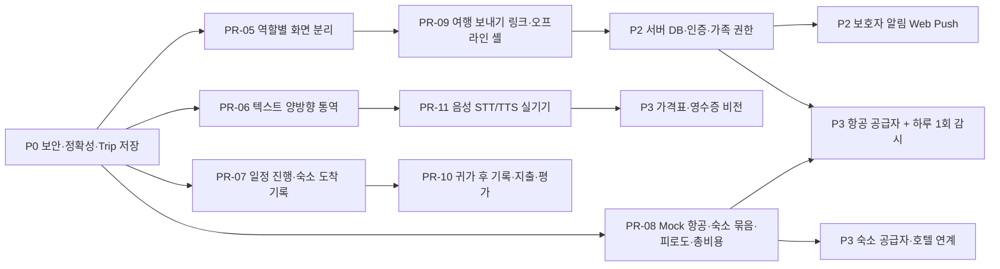

# easy-travel 로드맵

> 원칙: 의존성이 있는 순서대로, 작은 PR 단위로 진행합니다. 비용·계약·개인정보가 걸린 연동은 비교안과 질문을 먼저 올리고 승인을 받습니다.

## 의존 관계

## 단계별 계획

| 단계 | PR | 내용 | 신규 비용·외부 의존 | 승인 필요 |
|---|---|---|---|---|
| **P0** (완료, 브랜치 `claude/p0-hardening`) | PR-01 | Next 16/React 19, lockfile, ESLint, 보안 헤더 | 없음 | main 병합 |
| | PR-02 | 단일 Trip·목적지 프로필·저장소 이전·날짜 검증·목적지 시간대 | 없음 | |
| | PR-03 | `/api/ai` 보호(출처·접속 코드·횟수 제한·타임아웃·프롬프트 분리) | 없음 | Vercel에 `EASY_TRAVEL_ACCESS_CODE` 추가 |
| | PR-04 | 화면 정리(하이드레이션·데모 문구·죽은 링크·번역 칸 분리) | 없음 | |
| **P1** | PR-05 | 부모님 `/traveler` · 보호자 `/guardian` 분리, 컴포넌트 분할 | 없음 | 화면 구성안 |
| | PR-06 | 통역 방향 전환(한↔현지어), 원문/번역 큰 글씨, 언어 직접 변경 | OpenRouter(기존) | |
| | PR-07 | 일정 상태·시간, “도착했어요/다음으로”, 숙소 도착 기록(1회 위치 선택) | 없음 | |
| | PR-08 | Mock 항공·숙소 어댑터, 묶음 비교, 피로도·총비용 계산과 테스트 | 없음 | |
| | PR-09 | 여행 보내기 링크(서버 미전송), PWA 오프라인 셸 | 없음 | |
| | PR-10 | 귀가 후 타임라인·직접 지출·평가·다음 여행 조건 | 없음 | |
| | PR-11 | 음성 입력·읽어주기(Web Speech → OpenRouter 오디오 대안) | 오디오 토큰 소액 | 실기기 테스트(iOS·Android) |
| **P2** | PR-12 | 서버 DB(Neon)·로그인·가족 초대/철회·공유 범위·삭제/내보내기 | Neon 무료, 로그인 공급자 | DB·로그인 방식·개인정보 처리 방침 |
| | PR-13 | Web Push 보호자 알림(기록/전송/읽음 분리) | VAPID 키(무료) | 알림 채널 |
| **P3** | PR-14 | 항공 공급자 Spike(1–2일) → 어댑터 → 하루 1회 감시 | 공급자 가입(무료~소액) | 공급자·약관·빈도 |
| | PR-15 | 숙소 공급자 어댑터·호텔 연계 추천 Live | 공급자 가입 | 공급자·약관 |
| | PR-16 | 가격표·영수증 비전(사용자 확인 후 확정) | OpenRouter 비전(소액) | |
| **P4** | — | 확정 지출 기반 시세 참고(동의·익명 집계), 네이티브 앱(백그라운드 지오펜스) 검토 | 미정 | 별도 결정 |

## 2주 단기 목표 제안

P1의 PR-05 ~ PR-08(화면 분리, 텍스트 양방향 통역, 일정 진행·숙소 도착 기록, Mock 계획 품질)을 우선합니다. 실제 공급자 키와 약관이 확인되면 P3을 따로 일정에 잡습니다. 2주는 진행 속도를 모르는 상태의 추정이며, 일정을 보장하지 않습니다.

## 배포 전 사용자 작업

1. OpenRouter 대시보드에서 이 키의 사용 한도(credit limit)를 설정합니다.
2. P0 병합을 승인하면 Vercel 환경변수에 `EASY_TRAVEL_ACCESS_CODE`(가족 공유 코드)와 `OPENROUTER_SITE_URL=https://easy-travel-dosl.vercel.app`을 넣습니다.
3. 그다음 Vercel Authentication을 끄고, 부모님 기기의 ‘가족 여행 설정’에 접속 코드를 입력합니다.
